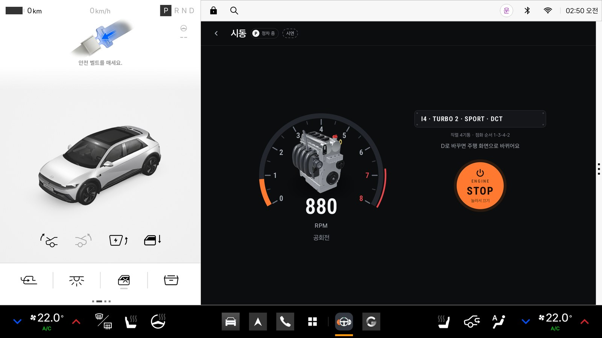

# Downshift (다운시프트)

> 차 안에서만 들리는 내 엔진 — 2026 현대자동차그룹 차량용 앱 개발 공모전 출품작



법규를 지키며 달려 모은 포인트로 가상 엔진을 조립·튜닝하고, 내 페달에 반응하는 그 엔진 소리를 차 실내 스피커로만 즐기는 Pleos Connect(AAOS) 앱입니다.

- **실시간 합성 엔진음.** 점화 순서대로 실린더마다 배기 펄스를 만들어 직렬 4기통·V8·V12를 녹음 음원 없이 냅니다. 페달·차속·기어에 따라 rpm이 오르내리고, 시동 굉음·정차 중 레브·감속 팝콘·다운시프트 블립이 납니다.
- **안전 주행 포인트로만 해금.** 거리 5P/km, 제한속도 준수 +1P/km, 스쿨존·단속 카메라 준수 +6P/곳, 회전 30m 전 방향지시등 +0.5P/회. 감점은 없고, 현금으로 사지 못합니다.
- **상황 인지 볼륨.** 내비 안내·통화가 나오면 −12dB, 스쿨존·주거지에서 −10dB, 동승자가 타면 볼륨 상한 40%.
- **실내 스피커 전용.** 외부 스피커와 보행자 경고음(AVAS)은 건드리지 않습니다. 주행 중에는 rpm·속도를 보여 주지 않습니다.

## 바로 실행하기 (심사용)

준비: Android Studio의 Pleos Connect Emulator v2.1.0 AVD(API 34, Automotive), PC의 adb. 기어·페달·좌석은 에뮬레이터 안의 Virtual Console로 바꿉니다(`adb forward tcp:8088 tcp:8088` 후 브라우저로 http://127.0.0.1:8088).

```bash
adb install -r apk/Downshift_release.apk
adb shell am start -n com.downshift.app/.MainActivity     # 처음 열 때 차속 등 권한을 묻습니다: 허용
```

1. 첫 실행 안전 안내에 동의하면 개러지로 갑니다.
2. 개러지 **세팅** 탭 맨 아래 **시연 모드**를 켭니다. 시연 지갑(3,000P)으로 바뀌고, 시연 버튼·배속·웹 페달이 나타납니다. 끄면 실제 지갑으로 돌아옵니다.
3. 웹 페달: `adb forward tcp:8790 tcp:8790` 후 브라우저로 http://127.0.0.1:8790 을 엽니다. 스페이스바(끝까지), 슬라이더(계속 밟기), 페달 그림 끌기, 게임용 페달로 밟습니다. 아래 진행자 버튼으로 기어 D·P, 스쿨존, 안내 음성, 동승자를 넣습니다.
4. 개러지에서 부품을 미리 듣고 → **이 빌드로 시동** → START를 0.9초 누르고 → 웹 페달로 레브 → 기어 D(주행 중에는 Pleos가 앱 화면을 가리고 소리와 기록만 이어집니다) → 기어 P면 결산.

권한을 미리 주려면 `bash tools/probe.sh grant`(앱은 운전자 사용자 10으로 돕니다).

## 시연 순서 (PT 약 4분, 영상 2분 35초)

| 장면 | 하는 일 |
|---|---|
| 1 첫 실행 | 실내 스피커로만, 안내와 경고가 먼저 |
| 2 개러지 | I4에서 V8 미리 듣기, 터보 3단·트랙 배기로 바꿀 때마다 달라지는 소리 |
| 3 시동 | START를 길게 → 바늘 스윕과 굉음 → 정차 중 레브(심사위원이 웹 페달로) |
| 4 주행 | 가속 → 팝콘 → 다운시프트 블립, 지시등 켠 회전, 스쿨존 조용 모드, 안내 음성 |
| 5 결산 | 항목별 포인트, 포인트로 V12 해금 |
| 6 V12 | V12로 다시 시동 |

```bash
bash tools/show.sh pt        # 장면마다 Enter (PT_AUTO=1 이면 한 번에, PT_PEDAL=web 이면 레브를 웹 페달에 맡김)
bash tools/show.sh video     # 같은 흐름을 소리와 함께 녹화 -> docs/m4/demo.webm, 자막 demo.srt, youtube.md
```

## 차량 데이터와 Pleos SDK

| 데이터 | 출처 (실제로 쓴 API) | 쓰는 곳 | 에뮬레이터 확인 |
|---|---|---|---|
| 차속·기어·연료 종류 | AAOS CarPropertyManager `PERF_VEHICLE_SPEED`, `GEAR_SELECTION`, `INFO_FUEL_TYPE` | rpm·가상 변속, P↔D 화면 전환, 차종별 동작 | 확인 |
| 방향지시등·주행계·좌석·브레이크 | Pleos Vehicle SDK 2.3.2 `registerTurnSignalState`, `registerDistanceDriven`, `registerSeatOccupancy`, `registerBrakePedalStatus` | 방향지시등 포인트, 거리 포인트, 동승자 볼륨 | 확인 (좌석은 콘솔과 반대로 읽혀 콘솔 연결 때 뒤집음) |
| 제한속도·카메라·주의구간·회전 안내 | Pleos NaviHelper 3.0.5 `onCurrentRoadSpeedLimit`, `onCameraAlert`, `onCautionPointInfo`, `onTBTInfo` | 포인트, 스쿨존 조용 모드 | 회전 안내만 옴 → 나머지는 시연 모드에서 주입 |
| 안내 음성·통화 | AudioManager `registerAudioPlaybackCallback` | 엔진음 자동 감소 | 확인 |
| 가속 페달 | SDK에 없음 → 시연은 Virtual Console(`/vehicle/controls`) | 엔진 부하·레브 | 콘솔 → 소리 중앙값 77ms |
| 주행 규제 | `distractionOptimized` 선언, CarUxRestrictions | 주행 화면 단순화 | 주행 중에는 Pleos 홈이 앱 화면을 가림(소리·기록은 이어짐) |

## 검증 결과 (Pleos Connect Emulator v2.1.0)

| 항목 | 결과 | 목표 |
|---|---|---|
| 단위 테스트 | 255개 통과 (`./gradlew testDebugUnitTest`) | 전부 |
| 페달 → 소리 | Virtual Console 중앙값 77ms, 웹 페달 중앙값 91ms(최대 105) | 중앙값 100ms 이하 |
| 주행 중 앱 CPU | 1코어의 15.1%(직렬 4기통)~17.5%(V12, 30분 평균), 4코어 전체의 약 4% | 4코어 기준 5% 미만 |
| 개러지 대기(엔진 꺼짐, 시연 모드·웹 페달 서버) | 1코어의 4.0% | 5% 이하 |
| 메모리 | PSS 134MB | 400MB 이하 |
| 콜드 스타트 | 중앙값 4.0초 | 10초 이내 |
| 30분 연속 주행 (V12, 33주기) | 재시작·크래시·ANR 0, PSS 108 → 128MB에서 안정 | 무중단 |
| 각본 주행 판정 | 기대값과 같음, 거리 = 콘솔 주행계 | 일치 |
| 다른 앱이 앞에 있을 때 | 엔진음과 주행 기록 유지(미디어 재생 포그라운드 서비스) | 유지 |

결과 문서: [`docs/m0-findings.md`](docs/m0-findings.md)(신호·오디오 검증), [`m1-results.md`](docs/m1-results.md)(사운드 엔진), [`m2-results.md`](docs/m2-results.md)(개러지·경제), [`m3-results.md`](docs/m3-results.md)(주행·안전·결산), [`m4-results.md`](docs/m4-results.md)(시연·제출).

## 구조

순수 Kotlin 코어(`core/`, android.* 없음, JVM 테스트)와 Android·Pleos 어댑터(`adapters/`), 화면(`ui/`)으로 나눴습니다.

- `core/powertrain` 가상 파워트레인·변속기·부하 추정, `core/synth` 실린더별 배기 펄스 합성(`EngineVoice`, `FiringPlans`), `core/sound`·`core/dsp` 흡기·팝콘 레이어와 배기 EQ·믹서, `core/runtime` 블록마다 파워트레인 → 디렉터 → 믹서
- `core/garage` 부품 표·해금·장착·번호판·소리 성향·미리 듣기, `core/trip` 거리·제한속도·스쿨존·카메라·방향지시등 판정과 포인트·결산 문구, `core/situation` 상황 인지 볼륨, `core/flow` 화면 흐름, `core/demo` 시연 규칙·웹 페달 메시지
- `EngineHost` 앱 전체가 쓰는 엔진, `DriveHost` 주행 기록·정산·상황 볼륨·화면 전환, `DemoHost` 시연 모드와 시연 지갑·웹 페달, `DriveService` 다른 앱이 앞에 있어도 엔진음과 기록을 잇는 포그라운드 서비스
- `adapters/` AudioTrack 출력, 재생 감지, AAOS 차량 속성, Pleos 차량 신호·내비 이벤트, Virtual Console 주행, 지갑 저장(`GarageRepository`), adb 명령(`DemoBus`, adb와 시스템만 보낼 수 있음), 웹 페달 서버(`PedalServer`)
- `ui/` 첫 실행, 개러지(부품 카드·3D 무대·세팅 탭), 시동, 주행, 결산 (Jetpack Compose)

## 빌드

JDK 17, 저장소는 ASCII 경로에 둡니다(AGP가 한글 경로를 거부).

```bash
export JAVA_HOME="/c/Program Files/Eclipse Adoptium/jdk-17.0.20.101-hotspot"
./gradlew testDebugUnitTest          # 단위 테스트 255개
./gradlew assembleRelease            # app/build/outputs/apk/release/app-release.apk (debug 키 서명)
./gradlew installDebug               # 에뮬레이터에 개발용 빌드
```

## 에셋과 라이선스

- 엔진음: 앱의 실시간 합성이라 저장소와 APK에 녹음 음원이 없습니다. 구매한 녹음 팩은 선택이고 라이선스상 저장소에 넣지 않습니다(`tools/pack_builder.py`가 사용자가 꺼낼 수 없는 `.dsa`로 바꿔 넣음, `app/src/main/assets/engines/`는 gitignore).
- 3D 엔진 렌더: 프로젝트의 three.js 코드로 만든 모델을 24장씩 렌더한 것.
- 부품 이미지: Figma AI로 생성(출처 `docs/m2/parts_source.md`).
- 글꼴: 시스템 Roboto.

## 알려진 제한

- 가속 페달 신호는 지금 SDK로 읽을 수 없습니다. 시연은 Virtual Console 페달이고, 실차에서는 차속 변화율로 부하를 추정합니다.
- 주행 중에는 Pleos 홈이 서드파티 앱 화면을 가립니다(정차 중 D에서도 가려질 때가 있음). Downshift는 그동안 소리와 기록으로 동작합니다.
- 에뮬레이터 내비는 제한속도·카메라·주의구간 이벤트를 보내지 않아, 시연 모드에서 adb나 웹 페달 진행자 버튼으로 넣습니다.
- 실차에서 아직 확인하지 못한 것: 내비 이벤트, 좌석 값, 차량 경고음과의 덕킹, 1칸(세로) 레이아웃.

## 개발 도구

```bash
R=com.downshift.app/.adapters.demo.DemoReceiver
adb shell am broadcast -n $R --es cmd demo --es value on --es buttons on          # 시연 모드 (지갑·버튼)
adb shell am broadcast -n $R --es cmd garage --es action reset                     # 시연 지갑 = 시연 상태 3,000P
adb shell am broadcast -n $R --es cmd garage --es action preview --es part v8      # unlock | equip | tab (개러지 화면에서)
adb shell am broadcast -n $R --es cmd drive --es event limit --ei kph 50           # camera | school | turn | lapse: 시연 모드에서만
adb shell am broadcast -n $R --es cmd drive --es event guide                       # 내비 안내음 대역
bash tools/show.sh wallet|latency|cpu|background|soak|coldstart|release|shots      # M4 확인 (docs/m4/)
bash tools/drive.sh flow|trip|persist|cpu|music                                    # M3 주행 확인 (docs/m3/)
bash tools/garage.sh flow|persist|cpu|mem|frames                                   # M2 개러지 확인 (docs/m2/)
bash tools/sound.sh scenario v8_turbo|latency|cpu                                  # M1 사운드 확인 (docs/m1/)
```

화면 위 작은 줄(개러지·사운드 랩·프로브)은 디버그 빌드에서만, 시연 모드가 꺼져 있을 때만 보입니다.
